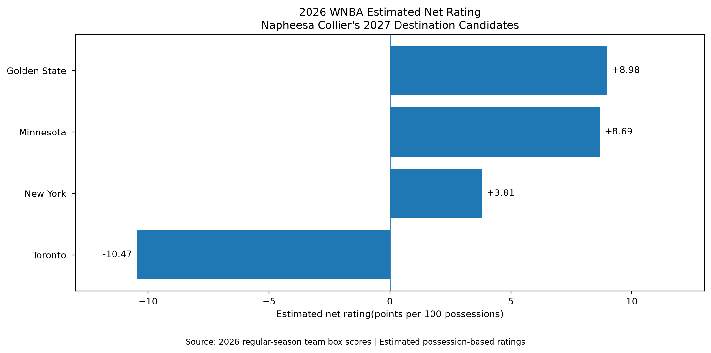
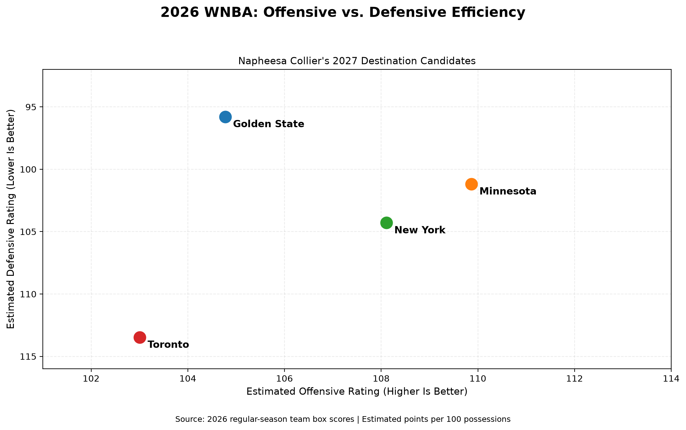

# Napheesa Collier: 2027 WNBA Free Agency Analysis

## Project Overview

This project evaluates 4 potential 2027 free-agency destinations
for WNBA All-Star Napheesa Collier using Python-based statistical
analysis, salary-cap modeling, and basketball scouting.

The objective is to identify which destination offers the
strongest overall opportunity for Collier, considering both
basketball fit and individual financial opportunity.

The analysis does not attempt to predict Collier's personal
decision or preferences.

## Teams Evaluated

- Minnesota Lynx
- Golden State Valkyries
- Toronto Tempo
- New York Liberty

## Research Question

Which of the four organizations provides the strongest
potential basketball and financial situation for Napheesa
Collier entering the 2027 WNBA season?

## Evaluation Methodology

Five weighted categories are used:

| Category | Weight |
|---|---:|
| Basketball Compatibility | 25% |
| Role and Opportunity | 25% |
| Competitive Outlook | 20% |
| Financial Opportunity | 15% |
| Stability and Continuity | 15% |
| **Total** | **100%** |

Each category receives a scouting grade on a 1–5 scale,
with supporting evidence and documented limitations.

## Analytical Components

The Python analysis examines:

- Team offensive and defensive efficiency
- League-wide Four Factors
- Player performance and roster construction
- Opponent strength and team consistency
- Collier's availability and Minnesota's performance
- Potential frontcourt combinations
- Hypothetical 2027 salary-cap scenarios
- Weighted destination evaluations

## 2026 Team Performance: Key Findings

The following visualizations compare the four potential
2027 free-agency destinations using estimated 2026
regular-season team performance.

These historical results establish a statistical baseline.
They do not predict Collier's decision or determine
which destination is the best overall fit.

### 1. Estimated Net Rating

Golden State (+8.98) and Minnesota (+8.69) recorded
similarly strong estimated net ratings, separated by
just 0.29 points per 100 possessions.

New York (+3.81) also finished with a positive
estimated net rating, while Toronto (-10.47)
faced a substantially larger performance gap.

These results should be interpreted alongside
injury availability, roster changes, and differences
in opponent strength.

### 2. Offensive vs. Defensive Efficiency

Although Golden State and Minnesota produced similar
overall net ratings, their statistical profiles differed.

**Golden State Valkyries**
- Estimated offensive rating: 104.77
- Estimated defensive rating: 95.79
- Primary strength: Elite defensive efficiency

**Minnesota Lynx**
- Estimated offensive rating: 109.87
- Estimated defensive rating: 101.18
- Primary strength: Strong offensive production
  combined with effective defense

**New York Liberty**
- Estimated offensive rating: 108.11
- Estimated defensive rating: 104.30
- Positive two-way performance, with room for
  improvement in defensive efficiency

**Toronto Tempo**
- Estimated offensive rating: 103.01
- Estimated defensive rating: 113.47
- Defensive improvement represents a significant
  potential opportunity

### Scouting Interpretation

Golden State's defensive foundation suggests Collier
could provide additional offensive creation while
contributing to an already strong defensive system.

Minnesota's established offensive production suggests
the challenge may be maximizing chemistry, distributing
creation responsibilities, and integrating Collier
within the existing team structure.

New York's existing talent and Toronto's developing
roster present different integration considerations.

These are scouting hypotheses informed by the data,
not measured projections of Collier's impact.

**Methodology note:** All ratings are estimated using
the project's possession-based calculations and may
differ from official league statistics.

## Data and Tools

- Python
- pandas
- WNBA schedule and box-score data
- Public salary-cap and contract information
- Basketball scouting and film observations

Source documentation and reproducibility instructions
will be expanded as the repository develops.

## Project Status

**Research and analysis in progress.**

Nineteen of twenty individual scouting grades have been
agreed upon.

Golden State's Competitive Outlook grade remains pending
the conclusion of the 2026 WNBA Finals.

Final weighted rankings will be published after all
evaluation categories are complete.

## Important Limitations

- The 2027 rosters are not finalized.
- Salary-cap calculations use hypothetical scenarios,
  not confirmed contract offers.
- Team chemistry and coaching projections involve
  qualitative scouting judgment.
- Historical performance does not guarantee future results.
- The final ranking reflects the model's assumptions,
  not Collier's personal preferences.

## Future Updates

- Final competitive-outlook evaluation
- Weighted destination rankings
- Sensitivity analysis
- Data visualizations
- Complete scouting report
- Reproducibility documentation

## Disclaimer

This is an independent basketball analytics portfolio
project and is not affiliated with the WNBA or its teams.
